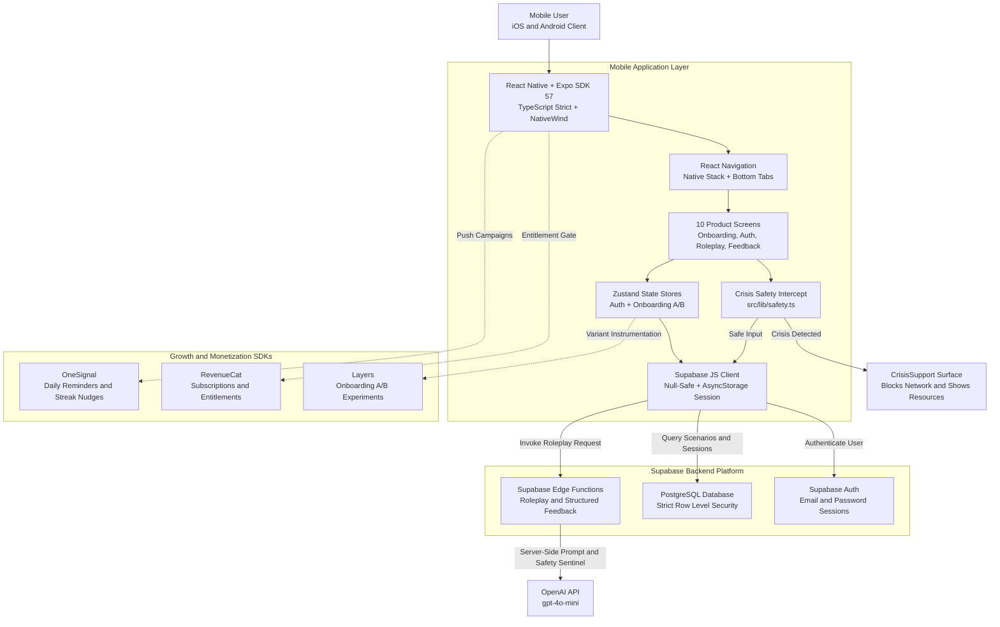
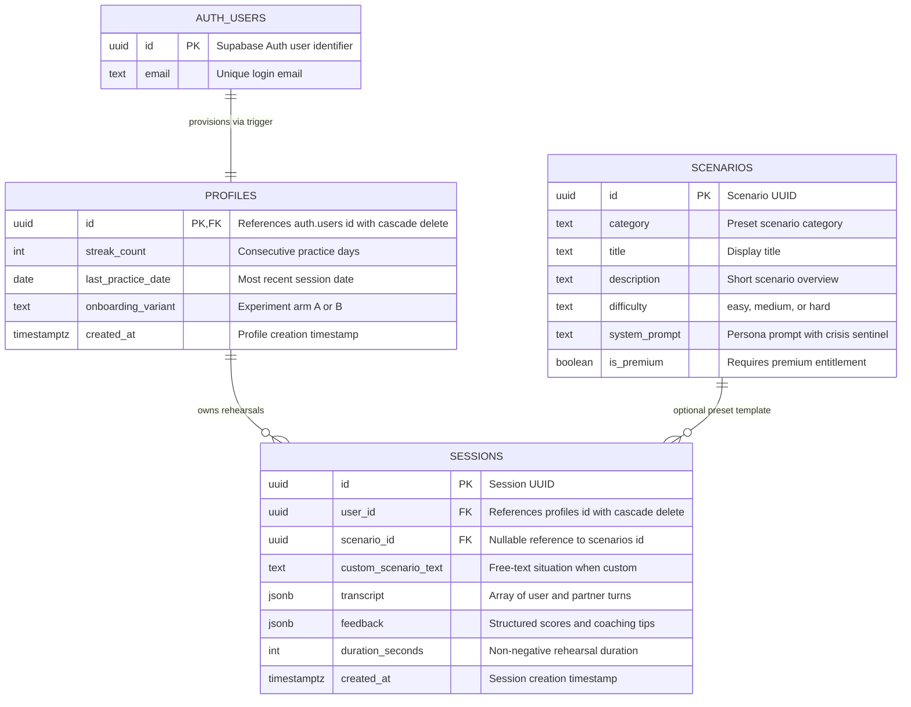

<div align="center">

# Rehearsly

**Rehearse the conversation you're dreading — with an AI partner who pushes back like a real person.**

A mobile confidence-building platform built with React Native, Expo SDK 57, and Supabase to practise difficult workplace, boundary, and family conversations and receive structured, actionable coaching feedback.

[](https://reactnative.dev/)
[](https://expo.dev/)
[](https://www.typescriptlang.org/)
[](https://www.nativewind.dev/)
[](https://supabase.com/)
[](LICENSE)

</div>

---

> [!IMPORTANT]
> Rehearsly is a confidence-building practice tool. It is **not** therapy, counselling, or crisis support, and it does not pretend to be — see [Safety & Crisis Intercept](#safety--crisis-intercept).

Built for the [RevenueCat Shipaton 2026](https://shipaton.revenuecat.com/).

---

## Project Status

Week 1 scaffold complete — the application is navigable end to end with verified database migrations, Row Level Security isolation, typed navigation, and a 46-test client safety layer.

| Area | State |
| :--- | :--- |
| Expo SDK 57 + TypeScript strict, NativeWind v4, unified design tokens | ✅ Done |
| Typed React Navigation shell with all 10 product screens routable | ✅ Done |
| Supabase email/password auth (sign up / sign in / sign out / delete data) | ✅ Done |
| PostgreSQL schema + explicit least-privilege RLS + 15 seeded scenarios | ✅ Done (verified against real Postgres) |
| Defense-in-depth crisis-safety intercept (`src/lib/safety.ts`) | ✅ Done (46 unit tests passing) |
| Onboarding A/B experiment assignment & persistence | ✅ Done (local seam ready for Layers) |
| Roleplay chat + OpenAI Supabase Edge Function | ⏳ Planned (Week 2) |
| Structured coaching feedback + RevenueCat paywall | ⏳ Planned (Week 3) |
| OneSignal daily reminder & streak-risk campaigns + store release | ⏳ Planned (Week 4) |
| Layers SDK live onboarding experiment | ⏳ Planned (Week 5) |

---

## System Architecture

All OpenAI calls route strictly through server-side Supabase Edge Functions so `OPENAI_API_KEY` never enters the mobile client bundle. Client-side crisis screening executes before any network I/O.



### Database Schema & Row Level Security

Managed via reproducible SQL migrations in [`supabase/migrations/`](supabase/migrations/) with explicit `GRANT` statements (`anon` can read the scenario catalogue and nothing else; `authenticated` users can only read and mutate their own `profiles` and `sessions`).



---

## Core Engineering Highlights

- **Zero-Crash Unconfigured Boot:** [`src/lib/env.ts`](src/lib/env.ts) and [`src/lib/supabase.ts`](src/lib/supabase.ts) initialize null-safely when environment variables are absent, letting reviewers explore the full UI shell with an explicit configuration banner instead of a crash.
- **Single-Source Design Tokens:** [`design-tokens.js`](design-tokens.js) feeds both [`tailwind.config.js`](tailwind.config.js) (for NativeWind utilities) and [`src/theme/tokens.ts`](src/theme/tokens.ts) (for React Navigation and native component props) with a warm, non-clinical paper palette.
- **Strict Database Integrity:** Automated `handle_new_user` trigger eliminates profile race conditions, `sessions_has_a_subject` enforces valid session targets at the SQL constraint level, and cascading foreign keys guarantee zero orphaned rows on account deletion.
- **Server-Only Secret Isolation:** `.env.example` documents that `OPENAI_API_KEY` is intentionally **not** prefixed with `EXPO_PUBLIC_`, preventing bundler inlining into shipped APK/IPA binaries.

### The Core Rehearsal Loop

1. **Pick a scenario** — Choose from 15 seeded presets across five categories (Workplace Feedback, Boundaries, Saying No, Difficult Family Talks, Career & New-Manager) or describe a custom situation.
2. **Roleplay** — Converse with an AI partner calibrated for realistic emotional resistance rather than instant agreement or endless stonewalling.
3. **End any time** — *"End & get feedback"* remains accessible throughout every rehearsal.
4. **Structured feedback** — Receive 1–5 scores across **Clarity**, **Empathy**, **Assertiveness**, and **Confidence**, plus one highlight and 2–3 specific, transcript-grounded tips.
5. **Streak retention** — Consecutive practice days build a visible streak reinforced by user-scheduled reminders.

---

## Safety & Crisis Intercept

Rehearsly rehearses everyday hard conversations and must never roleplay a crisis back at someone. [`src/lib/safety.ts`](src/lib/safety.ts) screens user free text for indicators of self-harm, suicidal ideation, abuse, or intent to harm others:

- **Pre-network execution:** Runs locally before any network I/O so crisis disclosures are never sent to an LLM provider.
- **Calibrated over-trigger bias:** Word-boundary anchored rules prioritize catching genuine distress while 14 pinned benign-phrasing tests (e.g., *"kill the project"*, *"this deadline is killing me"*) guard against noisy false positives.
- **Defense in depth:** Every seeded scenario prompt in [`supabase/migrations/20260811000300_seed_scenarios.sql`](supabase/migrations/20260811000300_seed_scenarios.sql) appends a shared house-rules block instructing the model to emit `__REHEARSLY_CRISIS_STOP__` instead of engaging, which the client intercepts via `responseTrippedSafety()`.
- **No escape hatch:** [`CrisisSupport`](src/components/CrisisSupport.tsx) presents support resources with no *"continue anyway"* bypass.

---

## Sponsor SDKs — Why Each Is Integrated

| SDK | Role in Rehearsly | Architectural Rationale |
| :--- | :--- | :--- |
| **RevenueCat** | Subscription paywall with one `premium` entitlement and one offering (weekly & annual packages), gating custom scenarios and 4+ weekly sessions. | Three free rehearsals/week let users experience real value; the upgrade trigger arrives naturally when preparing for an important conversation. Uses RevenueCat's prebuilt paywall UI. |
| **OneSignal** | Daily practice reminder at a user-chosen time plus an 8pm streak-risk nudge, tagging users with streak count for segmentation. | Rehearsal builds confidence through repetition; push notifications directly reinforce the core streak retention loop. |
| **Layers** | Onboarding A/B experiment comparing **Variant A** (pick a preset scenario first) vs **Variant B** (describe your own situation first) on first-roleplay completion. | Tests whether immediate personal relevance increases follow-through. Isolated behind a single assignment seam (`assignVariant` in [`src/stores/onboardingStore.ts`](src/stores/onboardingStore.ts)). |

---

## Repository Structure

```text
Rehearsly/
├── App.tsx                                       # Root providers: gesture handler, safe area, navigation
├── app.json                                      # Expo SDK 57 app & plugin manifest
├── eas.json                                      # EAS Build profiles (development, preview, production)
├── design-tokens.js                              # Single source of truth for palette, type & spacing
├── eslint.config.js                              # Expo flat ESLint configuration
├── tailwind.config.js                            # NativeWind v4 / Tailwind v3 theme bridge
├── .env.example                                  # Documented public vs server-only env template
├── src/
│   ├── components/
│   │   ├── ui/                                   # Reusable primitives: Screen, Button, Card, TextField
│   │   └── CrisisSupport.tsx                     # Non-bypassable crisis support modal surface
│   ├── lib/
│   │   ├── env.ts                                # Typed EXPO_PUBLIC_* accessor & diagnostics
│   │   ├── safety.ts                             # Pre-network crisis intercept & sentinel detection
│   │   ├── safety.test.ts                        # 46 unit tests for safety rules & benign phrases
│   │   └── supabase.ts                           # Null-safe Supabase JS client with AsyncStorage
│   ├── navigation/
│   │   ├── RootNavigator.tsx                     # Onboarding, Auth & main stack routing
│   │   ├── TabNavigator.tsx                      # Bottom tabs: Practice, Progress, Settings
│   │   └── types.ts                              # Global React Navigation strict param types
│   ├── screens/                                  # 10 screens: onboarding, auth, home, scenarios, roleplay, feedback, progress, paywall, settings
│   ├── stores/                                   # Zustand stores: authStore & persisted onboardingStore
│   ├── theme/tokens.ts                           # Typed token exports for native props
│   └── types/database.ts                         # TypeScript mirror of PostgreSQL schema & JSONB contracts
└── supabase/
    ├── migrations/
    │   ├── 20260811000100_init_schema.sql        # Tables, indexes, constraints & signup trigger
    │   ├── 20260811000200_row_level_security.sql # Explicit grants & per-table RLS policies
    │   └── 20260811000300_seed_scenarios.sql     # 15 seeded scenarios with shared safety house rules
    └── tests/
        ├── run.sh                                # Throwaway Postgres cluster migration & RLS test runner
        ├── 00_supabase_stubs.sql                 # Auth schema & role stubs for isolated local testing
        ├── 01_rls_isolation.sql                  # Cross-user isolation & anon least-privilege assertions
        └── 02_schema_shape.sql                   # Trigger, constraint, cascade & sentinel checks
```

---

## Getting Started

### Prerequisites

- **Node.js 20+** and **npm**
- An **Expo** account (for EAS / physical device builds)
- A **Supabase** project (optional for UI exploration; required for auth and database persistence)
- Local **PostgreSQL** (`initdb`, `pg_ctl`, `psql`) — optional, only for running `./supabase/tests/run.sh`

### 1. Clone & Configure Environment

```bash
git clone https://github.com/theekshana-sudeepa/Rehearsly.git
cd Rehearsly
npm install
cp .env.example .env
```

Fill in `.env` with your project's public keys (`EXPO_PUBLIC_SUPABASE_URL`, `EXPO_PUBLIC_SUPABASE_ANON_KEY`, and SDK keys as you enable them). Never put `OPENAI_API_KEY` in an `EXPO_PUBLIC_` variable — configure it strictly as a Supabase Edge Function secret:

```bash
supabase secrets set OPENAI_API_KEY=sk-...
```

### 2. Apply Supabase Migrations

Apply the SQL migrations in filename order via the Supabase SQL Editor or the Supabase CLI:

```bash
supabase link --project-ref <your-project-ref>
supabase db push
```

### 3. Run the Application

```bash
npm start          # Start Expo Metro dev server
npm run android    # Build & run native Android target
npm run ios        # Build & run native iOS target
npm run web        # Launch web preview
```

### 4. Verify Code Quality & Database Security

```bash
npm run lint                # Expo ESLint checks
npm run typecheck           # TypeScript strict verification
npm test                    # 46 Jest safety-intercept tests
./supabase/tests/run.sh     # Throwaway Postgres RLS & schema verification
```

### Pinned Technical Decisions

- **`tailwindcss` is pinned to v3 (`^3.4.19`):** NativeWind v4 is incompatible with Tailwind CSS v4.
- **`babel-preset-expo` is a direct `devDependency`:** Expo SDK 57 nests it under `expo/node_modules`, so direct declaration guarantees reliable Babel resolution.

---

## License

Distributed under the **MIT License**. See [`LICENSE`](LICENSE) for full details.

---

<div align="center">

**Built by [Theekshana Sudeepa](https://github.com/theekshana-sudeepa)**

[LinkedIn](https://www.linkedin.com/in/theekshana-sudeepa/) · [GitHub](https://github.com/theekshana-sudeepa) · [LexoraTech](https://lexoratech.com)

</div>
